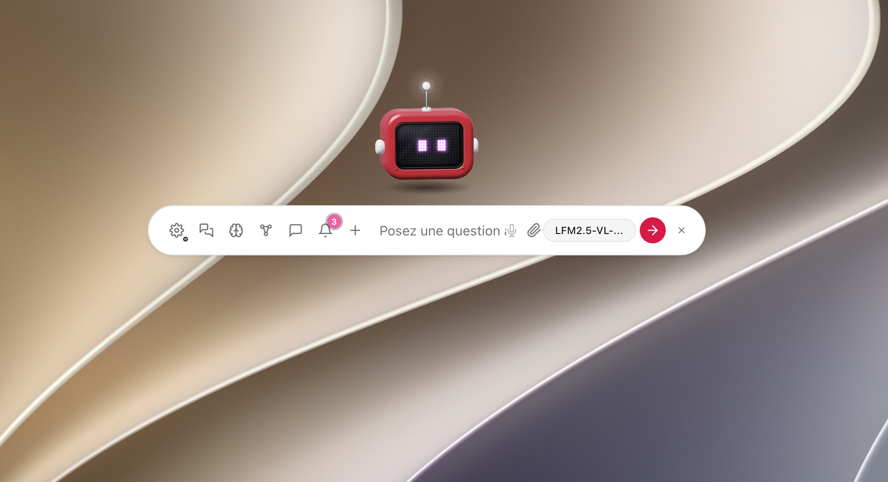

# Lumen

**Un environnement de travail avec une IA locale, des applications et des agents.**

Lumen est une application de bureau Tauri : une barre flottante accessible par
raccourci, une interface de discussion **Application**, ou un **Bureau** avec
fenêtres, dock et applications. Les mêmes outils peuvent être utilisés par
l'assistant, les agents et les automatisations Fluxo.



Le code original et sa documentation sont sous **GPL-3.0-or-later**.
Les bibliothèques, modèles, voix et images tiers conservent leurs licences :
[licence](LICENSE.md), [texte GPL complet](COPYING),
[inventaire des composants](THIRD_PARTY_NOTICES.md).

## Capacités

Cette présentation suit la documentation intégrée, accessible depuis Lumen et
consultable dans [src/docs/docs.html](src/docs/docs.html). Certaines applications
s'installent depuis le Catalogue ; les intégrations dépendent du système et du matériel.

| Domaine | Fonctions |
| --- | --- |
| Assistant | Accès rapide discret (⌘⌥P sur macOS, Ctrl+Alt+P ailleurs), conversations, pièces jointes, projets, contexte documentaire, outils, routage local des demandes, orchestration par étapes et proposition de recours à un fournisseur distant |
| Équipage | Agents, skills, mémoire, tâches planifiées/Heartbeat, fil de messages, traces, profiler et diagnostic |
| Fluxo | Automatisations par blocs, workflows, déclencheurs et outils utilisables par l'IA ; blocs GPIO sur Raspberry Pi |
| Corpus / Prisme | Import documentaire, indexation RAG locale, recherche et citations ; tables SQLite, exploration et préparation de données, atelier ML |
| Muse | Notes, mindmaps, moodboards et canvas d'idées ; documents vivants et mentions d'agents |
| Opus / Calc | Documents et présentations, tableur avec formules, import/export et outils de PDF |
| Études | Cours, fiches, quiz et numérisation locale des images et PDF scannés avec OCR GGUF |
| Tempo | Agenda, tâches, rappels et tableaux Kanban |
| Forge | Génération de mini-applications HTML, édition de code et intégration avec les outils de l'assistant |
| Web / communication | Navigateur natif, lecture et recherche web, courrier, carnet d'adresses ; passerelles Telegram et Slack configurables |
| Audio / image | Dictée locale whisper.cpp ou système, synthèse vocale, studio de voix et podcasts ; génération d'images avec moteurs téléchargés séparément ou intégrations Apple compatibles |
| Applications métier | Relia (CRM et facturation), réunions LAN, DB Studio, reporting et sources de données en lecture seule, flux de transformation |
| Matériel / mobilité | Compagnon iOS, serveur compagnon LAN, interfaces XR/WebXR, orbes ESP32 et M5, contrôleur et robotique |
| Gestion locale | Sandboxes, permissions des paquets, sauvegarde/restauration et paramètres des modèles |

Le noyau et les **43 paquets déclarés dans le catalogue** sont séparés : les
applications s'installent et se retirent depuis le Catalogue. Les permissions
demandées sont déclarées par paquet. Les variantes Bureau/Application et les
fenêtres natives partagent des modules, mais ne proposent pas toujours les mêmes
intégrations sur chaque plateforme. L'ancien Atelier des agents est en sommeil.

### Moteurs d'IA

- **Ollama** : serveur local ou serveur choisi dans les réglages.
- **llama.cpp** : serveur embarqué construit avec l'application ; modèles téléchargés séparément.
- **Apple Foundation Models** : passerelle Swift optionnelle, selon le SDK,
  le système et la disponibilité d'Apple Intelligence. L'intégration Raccourcis
  constitue un chemin distinct sur les systèmes compatibles.
- **API compatible OpenAI** : fournisseur distant optionnel, configuré par l'utilisateur.

Deux chemins supplémentaires peuvent apparaître selon la configuration :
**LiteRT-LM** lorsque son runtime est embarqué (notamment sur Pi), et
**Lumen Server** pour les modèles d’un serveur associé. Raccourcis macOS
reste également une source distincte, aux capacités plus limitées.

Les outils disponibles dépendent du moteur et du modèle. Le routage et
l'orchestration aident les petits modèles, sans garantir la qualité des réponses.
Le mode hybride propose un nouvel essai distant après un échec local.

### Données et réseau

L'inférence, les conversations, les documents et le RAG peuvent rester locaux.
Les fonctions web, API distante, e-mail, Slack, Telegram, synchronisation ou
compagnon réseau communiquent avec les services configurés. Les mises à jour,
le catalogue et le téléchargement de modèles utilisent aussi le réseau.
Lumen peut fonctionner hors ligne une fois les composants nécessaires installés ;
les fonctions connectées restent alors indisponibles.

Les sauvegardes `.lumenbackup` se créent dans **Réglages → Sauvegarde et mises
à jour**. Elles transportent les données applicatives ; modèles et voix se
récupèrent séparément. Voir la [politique de confidentialité](docs/privacy-policy.md).

## Construire depuis les sources

### Prérequis communs

- **Node.js 22.12+** et npm ; utiliser `npm ci` avec le lockfile fourni.
- **Rust stable >= 1.89**, Cargo et les outils natifs de la plateforme.
  Vérifier `rustc --version` et `cargo --version` : un ancien Rust installé par
  un gestionnaire de paquets peut masquer celui de rustup dans le PATH.
- **zip et unzip** pour construire le catalogue avec `apps:package`.
- **Git et CMake** pour construire llama.cpp et whisper.cpp. Leurs versions
  sont fixées dans `config/llama-cpp.version` et `config/whisper-cpp.version`.
- **Python 3.11+** pour l'export source et Sync Hub ; il n'est pas requis pour
  la simple interface JavaScript. Les moteurs Python optionnels ont leur runtime propre.
- Accès réseau pour récupérer les dépendances et les sources des moteurs au
  premier build. Le téléchargement des modèles est distinct et peut être volumineux.

Les sources publiques ne contiennent ni modèles, ni caches Cargo, ni moteurs
précompilés. Le frontend utilise des modules JavaScript natifs ; un staging de
livraison prépare `dist/frontend`, sans convertir le projet en application React.

### macOS

Installer les Command Line Tools Xcode (`xcode-select --install`), Rust via
rustup, Node.js, Git et CMake. Avec Homebrew, les outils non Apple peuvent être
installés par `brew install node@22 cmake git` ; ajouter Node 22.12+ au PATH si nécessaire.

```bash
npm ci
npm run tauri dev
```

La barre peut démarrer sans moteur prêt : configurer Ollama ou construire les
moteurs embarqués. Pour les tester en développement :

```bash
npm run build:llama
npm run build:whisper
npm run tauri dev
```

Pour produire `.app` et `.dmg` :

```bash
npm run build:mac
```

Ce script prépare le frontend, les moteurs et tente les passerelles Swift
optionnelles. Ces passerelles nécessitent un SDK récent compatible ; leur
absence n'empêche pas l'utilisation des autres moteurs. Un build pour sa
machine peut être signé ad hoc ; la distribution notarisée nécessite son
propre certificat Apple et la configuration décrite dans [docs/release.md](docs/release.md).

### Linux (Debian / Ubuntu)

```bash
sudo apt-get update
sudo apt-get install -y build-essential libwebkit2gtk-4.1-dev libxdo-dev \
  libssl-dev librsvg2-dev libudev-dev pkg-config curl wget file git cmake
npm ci
npm run tauri dev
# Paquets .deb et AppImage, sans lancer le build avec sudo :
bash scripts/build-linux.sh
```

Le script de prérequis dédié est `scripts/install-prereqs-linux.sh`.
Pour Raspberry Pi 64 bits : utiliser `scripts/install-prereqs-pi.sh`, puis
`bash scripts/build-pi.sh` afin d'activer les blocs matériels. Voir
[Linux](docs/linux.md) et [Raspberry Pi](docs/raspberry-pi.md).

Un compositeur est nécessaire à la transparence sous X11. Ne pas activer
`WEBKIT_DISABLE_DMABUF_RENDERER=1` par défaut : cela peut dégrader les couleurs
WebGL. Le contournement reste explicite via `LUMEN_DISABLE_DMABUF_RENDERER=1`.

### Windows

Installer Rust avec la cible MSVC, les **Visual Studio Build Tools C++**, le
Windows SDK, **WebView2**, Node.js 22.12+, Git et CMake. Depuis un terminal utilisateur :

```powershell
npm ci
npm run tauri dev
powershell -ExecutionPolicy Bypass -File .\scripts\build-windows.ps1
```

Les variantes CPU/CUDA/Vulkan des moteurs et les prérequis GPU sont détaillés
 dans [docs/windows.md](docs/windows.md). CUDA nécessite son toolkit ; ce n'est
pas un prérequis au build CPU.

### Catalogue et ressources optionnelles

```bash
npm run build:frontend             # noyau dans dist/frontend
npm run apps:package               # dist/apps/*.lumenapp + index.json
npm run apps:install-local         # installer les paquets pour le développement
```

Le build de livraison lance aussi les scripts de construction llama.cpp et
whisper.cpp définis par `beforeBuildCommand`. Les modèles se choisissent dans
les réglages. Piper, les voix, Bonsai et les composants matériels ne sont pas
nécessaires à tous les usages. Leurs scripts d'installation et licences sont
distincts. Les scripts `setup-*` installent des moteurs et modèles pour
l'utilisation ; ils ne remplacent pas la compilation de Lumen.

La signature et la publication du catalogue nécessitent **tes propres clés**.
Ne pas réutiliser les clés ou endpoints de l'éditeur pour un fork : configurer
les endpoints catalogue/updater avant de diffuser ses builds. Voir
[architecture des paquets](docs/ARCHITECTURE-APPS.md) et [release](docs/release.md).

## Développer et vérifier

```bash
npm test
npm run eval:orch
npm run build:frontend
npm run apps:package
cargo test --manifest-path src-tauri/Cargo.toml --lib --locked
npm run security:audit
npm run security:sbom
npm run licenses:collect
```

Le banc d'orchestration utilise un modèle scripté : il ne mesure pas la qualité
d'un vrai modèle. Certains tests ouvrent un serveur sur `127.0.0.1` et exigent
que l'environnement le permette. Les essais avec modèles réels, appareils et
installateurs complètent la CI macOS/Windows/Linux/iOS.

Un correctif local documenté de `object` permet à espflash d'utiliser le
décompresseur `ruzstd` corrigé : [détails](src-tauri/crates/object/LUMEN-PATCH.md).
Aucune alerte de sécurité n'est masquée par ce patch.

## Dossier de publication et Sync Hub

Le dossier de travail du mainteneur conserve sa configuration APFS et ses
machines de build. Le miroir public se régénère indépendamment :

```bash
npm run source:plan                # aperçu, aucune copie
npm run source:sync                # synchronise public-source/
# Autre destination, vide au premier export :
python3 scripts/export-source.py --out /chemin/vers/lumen-public
npm run synchub                    # onglet « Code source »
```

Le script utilise une liste de répertoires autorisés, filtre les données
locales et génère un `dev.sh` portable et une configuration Sync Hub d'exemple.
Il ne copie pas `src-tauri/.cargo/config.toml`, les cibles réseau privées,
clés, bases locales, caches, modèles, anciennes releases et rapports de travail.
Les packs Gaming/Cosy et MetroCity, sans preuve de redistribution jointe,
sont exclus du miroir ; les ressources libres identifiées sont conservées.

Les exports suivants retirent uniquement les anciens fichiers gérés par le
manifeste. Ils préservent `.git` et les fichiers étrangers ; une modification
locale d'un fichier exporté provoque un arrêt pour éviter de l'écraser.
L'export **ne crée aucun commit et ne pousse rien sur Internet**. Le contrôle
anti-secrets est une défense partielle ; examiner la sélection avant le premier push.
Voir [docs/source-publication.md](docs/source-publication.md) et
[tools/synchub/README.md](tools/synchub/README.md).

## Structure

```text
src/                      Interfaces, applications et modules partagés
  lib/                    IA, interop, composants, ressources tierces
  docs/                   Documentation utilisateur intégrée
  legal/                  Informations GPL et texte complet embarqué
src-tauri/                Backend Rust et configuration Tauri
  crates/fluxo-engine/     Moteur d'automatisation intégré (MIT)
  crates/object/           Adaptation de dépendance documentée (MIT/Apache)
scripts/                  Build, catalogue, tests, audit et export source
config/                   Versions des moteurs embarqués
tools/synchub/            Pilotage des builds et export public
ios-companion/            Compagnon Apple ; projet généré avec XcodeGen
lumen-server/             Serveur autonome et sa console
docs/                     Architecture, guides et procédures
```

[Contribuer](CONTRIBUTING.md) · [Sécurité](SECURITY.md) ·
[Runtime agents](docs/agent-runtime.md) · [Interop](docs/interop.md) ·
[Documentation utilisateur](src/docs/docs.html)

### Décision, OCR et accès rapide

Le Catalogue propose **Kev 0.8B Q8, 4B Q4_K_M et 9B Q4_K_M**, au format GGUF pour le moteur de décision System One de llama.cpp. « Utiliser » choisit le modèle de décision.

Dans **Catalogue → Modèles → OCR**, téléchargez **GLM-OCR 0.9B Q8** (environ 1,43 Go avec projecteur) ou **PaddleOCR-VL 1.6 0.9B** (environ 1,82 Go). Le téléchargement utilisateur vient de Hugging Face ; les poids et le projecteur GGUF restent séparés du code publié. Dans Études, le sélecteur d’import propose aussi ce téléchargement. Les images PNG/JPEG/WebP/BMP et les pages de PDF sans texte exploitable passent par le modèle local ; le texte natif est conservé. Aucun service OCR distant n’est appelé. Limites : 200 pages, 400 000 caractères et 4 096 tokens de transcription par page ; une page tronquée provoque une erreur explicite. Annuler arrête l’import après la requête courante et ignore son résultat. Relisez la transcription avant de l’utiliser.

**⌘⌥P** (macOS) ou **Ctrl+Alt+P** (Windows/Linux) ouvre une petite fenêtre de question/réponse, avec le modèle de discussion déjà configuré. Si le raccourci est occupé, repli sur **Alt+Maj+P** ; le menu de l’icône Lumen propose aussi « Question rapide… ». Entrée envoie, Maj+Entrée ajoute une ligne, Échap masque et annule la réponse. Le mode n’ajoute pas de conversation à l’historique et ne lance aucun outil. Le fournisseur configuré reste affiché ; une configuration API distante y envoie la question.
