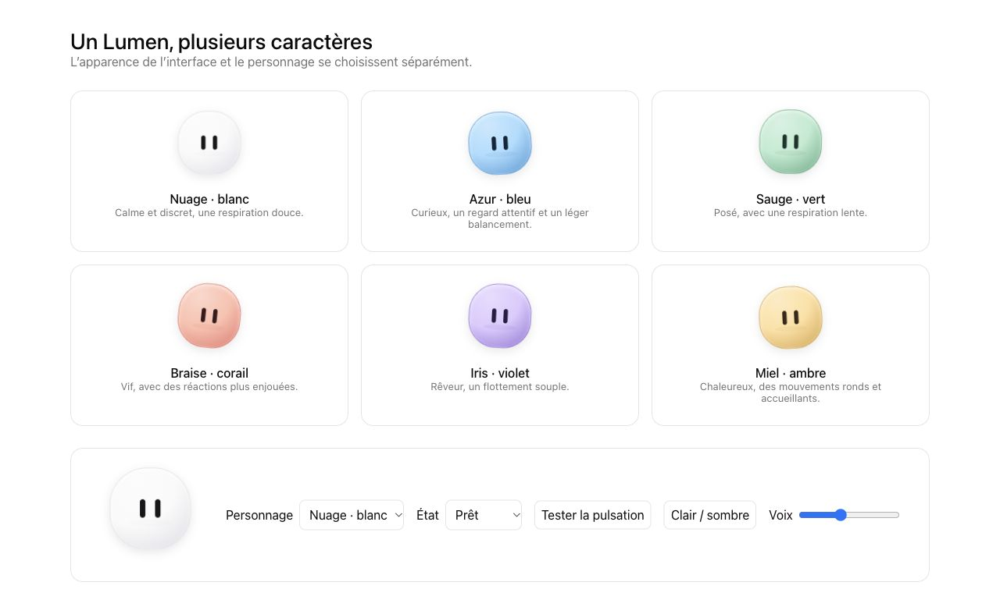

# Personnages Lumen et continuité entre modes

## Personnalisation livrée

Deux choix indépendants : Apparence de l’interface (clair/sombre, teinte de fond, accent, arrondis et habillage existants) ; Personnage Lumen (Original et six variantes douces). Les variantes ne recolorent plus les boutons, la barre ou le texte.

Nuage blanc calme ; Azur bleu curieux ; Sauge vert posé ; Braise corail vif ; Iris violet rêveur ; Miel ambre chaleureux. Chaque personnage possède couleur, ombre, couleur des yeux, rythme de respiration et amplitude de balancement propres. Taille, amplitude vocale, activation/intensité/vitesse de pulsation restent réglables. Les couleurs internes, le verre et le GLB restent disponibles pour Original, sans encombrer les variantes prêtes à l’emploi. Anciennes préférences colorées résolues vers la nouvelle famille correspondante ; préférences inconnues ramenées à Original. Les anciennes valeurs stockées ne sont pas effacées.

Le même composant `soft-orb.js` et le même catalogue `orb-characters.js` servent les fenêtres qui utilisent `orb.js`. Application réutilise désormais le véritable conteneur de l’orbe, déplacé de l’accueil vers l’en-tête pendant la discussion : plus de deuxième mascotte blanche indépendante. Desktop conserve ses règles de taille et de position. Le pont vers l’orbe physique traduit les nouveaux identifiants vers les palettes déjà reconnues par son firmware ; son graphisme reste spécifique à l’appareil. Le choix passe par le circuit existant des réglages et événements Tauri.

Animations : respiration, clignements, regard vers le pointeur, réflexion, écoute, parole, activité d’outil, pulsation et réaction au toucher. Retour au repos accompagné d’un bref rebond, sans signifier qu’une opération a réussi. Expressions respectent le réglage existant ; animations respectent `prefers-reduced-motion` et sont suspendues quand le document est masqué. En mode performance, les variantes douces peuvent rester visibles sans création d’un contexte WebGL ; la politique existante coupe leurs animations. En mode normal, le moteur 3D original reste disponible et sa boucle de rendu WebGL est arrêtée quand une variante douce est sélectionnée : son contexte reste alloué pour permettre le retour à Original.

Référence de mouvement : [Coucou](https://github.com/Louis-CFM/coucou), notamment respiration, regard et réactions expressives. Graphisme, noms et animations CSS Lumen créés dans ce projet ; aucun personnage, son ou asset Coucou repris.

Validation : 182 tests JavaScript passent ; 42 paquets du catalogue construits ; 369 fichiers de code du noyau contrôlés sans import local manquant. Tests de compatibilité des identifiants et d’indépendance de la palette ; suites JavaScript existantes ; analyse syntaxique CSS ; construction du frontend. Prévisualisation avec le vrai moteur dans un navigateur : Original, six variantes, réflexion, parole, pulsation et déplacement dans l’en-tête Application contrôlés. Ces essais ne remplacent pas un essai des événements interfenêtres dans le binaire natif. Pages `__preview-*` exclues des builds.

## Proposition : un moteur, trois présentations

La suite ci-dessous est une proposition de fonctionnement, pas une migration déjà exécutée.

| Mode | Expérience | Présentation des outils |
| --- | --- | --- |
| Barre | Demander, joindre un document, obtenir ou reprendre un résultat rapidement | Choix automatique des capacités utiles ; progression courte ; détails dépliables |
| Application | Discussions et projets, documents et résultats consultables sans organiser des fenêtres | Onglets simples : Discussion, Documents, Résultats, Activité ; applications spécialisées à la demande |
| Desktop | Atelier avancé : plusieurs apps et documents ouverts, opérations contrôlées en détail | Accès manuel complet aux applications, fenêtres et consoles de tâches |

Changer de mode conserve la discussion, le projet, les sources, le modèle compatible et les résultats. La disposition des fenêtres et la densité d’information sont propres à la vue. Aucun « assistant Desktop » distinct ne recrée sa mémoire ou sa conversation à chaque changement.

### 1. Un magasin de discussions et de projets

Actuellement Desktop lit le magasin de la barre et celui de son profil, tandis que la barre/Application lit son propre `saved_conversations`. Desktop écrit dans le magasin d’origine. Cette compatibilité est utile mais asymétrique ; elle n’est pas une continuité complète.

Cible : stockage canonique transactionnel côté Rust/SQLite, par profil et espace de travail. Une discussion possède un UUID stable, un projet, des messages, des références de pièces jointes durables, une révision, le modèle utilisé et des résultats. `origin` reste une métadonnée descriptive, jamais une décision de stockage. Un service commun charge/enregistre les discussions ; les vues s’abonnent aux changements et choisissent le même identifiant de discussion active.

Migration : copie de sécurité, inventaire des magasins par profil, import idempotent, traitement explicite des collisions d’identifiants temporels, préservation des épingles/projets et de la séparation des profils. Relecture et comptage avant activation ; anciennes données gardées pendant la transition. Les images éphémères doivent devenir des références durables avant qu’on promette une reprise complète.

### 2. Un runtime de conversation partagé

Extraire les règles de préparation du contexte, la boucle d’outils, le streaming, l’annulation et la persistance dans un runtime commun. Application, barre et Desktop deviennent des adaptateurs d’affichage. Le contexte documentaire et les choix de backends déjà mutualisés constituent une première base.

Une seule génération active par discussion ; changer de vue ne lance pas un deuxième appel modèle. L’exécution appartient à un service de session, avec événements séquencés et état durable. La nouvelle vue se rattache à la génération en cours. Une annulation provenant d’une vue s’applique partout ; une opération interrompue ne se rejoue pas automatiquement au redémarrage. Reprise d’interface et reprise d’exécution sont deux contrats différents.

### 3. Des capacités communes aux apps et au tool calling

Ne pas recréer chaque application sous forme d’un second outil. Extraire ses opérations métier dans un service partagé : lecture/recherche de documents, transformation de tableaux, calculs, création de fichiers, préparation de rapports, agenda et workflows. L’interface de l’app et l’outil de l’assistant appellent la même opération et reçoivent le même format de résultat.

Un registre de capacités indique : identifiant, schéma d’entrée/sortie, permissions, paquet installé, dépendances plateforme/modèle, coût et annulation possible. L’assistant propose uniquement les opérations disponibles et autorisées ; les préférences actuelles de publication des outils restent respectées. Une app désinstallée n’est pas une capacité disponible. L’orchestrateur charge les schémas pertinents à la demande, plutôt que le catalogue entier à chaque tour.

Barre/Application : opérations locales de lecture et créations réversibles dans l’espace autorisé exécutées automatiquement ; une activité courte explique ce qui se passe. Envoi externe, suppression ou autre opération demandant une validation garde son étape de confirmation. « Discret » signifie cacher la complexité de l’interface, pas masquer les actions ni élargir les permissions.

Les fournisseurs sans tool calling compatible doivent afficher une capacité limitée ou utiliser un chemin d’exécution déjà validé, jamais inventer qu’une opération a été effectuée.

### 4. Des résultats qui se transportent entre modes

Chaque opération produit un résultat typé : tableau, graphique, document, image, fichier ou workflow, rattaché au projet. Le chat montre une carte compacte ; Application permet sa consultation ; « Ouvrir dans Desktop » utilise le même résultat dans l’application appropriée. L’artefact original ne doit pas être reconstruit depuis une réponse textuelle à chaque ouverture.

Exemple : « Analyse ce CSV et prépare un graphique » → service de tableaux/analyse → résultat enregistré → aperçu dans le chat → reprise dans l’application Desktop, sans nouveau chargement ni second calcul implicite.

### 5. Une couverture mesurée

Les « trois quarts de Desktop » doivent se définir par des parcours réussis, pas par le nombre de boutons masqués. Première cible : recherche documentaire, résumé multi-documents, analyse CSV, graphiques, rapport exportable, recherche web avec sources, consultation d’agenda, préparation de brouillon, workflow connu et reprise d’un projet. Les opérations graphiques très interactives, création de mondes, édition complexe et pilotage matériel restent naturellement mieux adaptés à Desktop.

Vérifier chaque parcours avec les mêmes entrées/résultats dans les trois vues ; vérifier aussi annulation, permissions, erreurs, modèles sans outils, paquet absent et changement de vue pendant un appel. La couverture fonctionnelle sera annoncée après ces essais, pas comme un pourcentage déjà acquis.

### Ordre de réalisation recommandé

1. Magasin commun et migration sûre des discussions/projets.
2. Runtime partagé et rattachement à une session en cours.
3. Trois capacités pilotes de bout en bout : documents, tableaux et rapports.
4. Cartes de résultats et ouverture du même artefact dans Desktop.
5. Extension progressive du registre selon les parcours validés.

Cela garde l’identité d’atelier du Desktop tout en donnant à la barre et à Application un accès utile à ses fonctions, sans transformer ces deux vues en catalogues d’applications.
